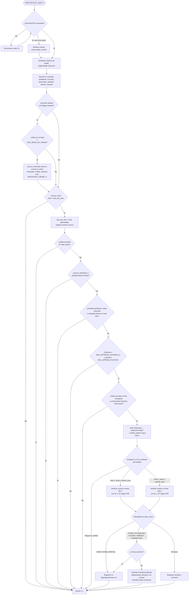

# Guía Operativa y Ejecución en Tiempo Real 🤖

Instrucciones para la ejecución automatizada, la gestión de riesgos y el bucle de trading en vivo conectado a **MetaTrader 5**.

---

## ⚙️ 1. Parámetros de Riesgo y Operaciones

Cada orden enviada por el bot incorpora protección estricta desde su creación en la API de MT5 (`mt5.order_send`).

### Configuración de Parámetros

| Parámetro | Valor por defecto | Descripción |
| :--- | :--- | :--- |
| `VOLUMEN` | `0.01` lotes | Tamaño fijo de la posición cuando `RIESGO_PCT` es `None`. |
| `RIESGO_PCT` | `None` | Si se define (ej. `0.005` = 0.5% del capital), el lote se calcula según el riesgo por operación (ver abajo). |
| `SL_MULTIPLICADOR_ATR` | `1.5` | Stop Loss dinámico según la volatilidad actual (`1.5 * ATR(14)`). |
| `TP_MULTIPLICADOR_ATR` | `3.0` | Take Profit dinámico (Relación Riesgo/Beneficio 1:2). |
| `MAX_BARS_EN_TRADE` | `48` velas | Time stop (12 h en M15): cierra la posición a mercado. Igual a la barrera temporal `N` del target. |
| `MAX_SPREAD_PUNTOS` | `25` puntos | Filtro de spread: no opera si el spread actual supera este límite (noticias/apertura). |
| `VELAS_CONTIGUAS_MIN` | `60` velas | Las últimas velas cerradas deben ser consecutivas hasta la vela actual (salvo el fin de semana); si no, los datos están atrasados o incompletos y no se entra. |
| `MAX_RETRASO_ENTRADA_S` | `60` segundos | No entra si la vela nueva se detecta más tarde de esto tras su apertura (arranque, reconexión). |
| `DESVIACION_SLIPPAGE` | `20` puntos | Tolerancia máxima de deslizamiento de precio en la ejecución. |
| `MAGIC_NUMBER` | `202601` | Identificador único para gestionar solo las órdenes de este bot. |
| `PERMITIR_CUENTA_REAL` | `False` | El bot se detiene si la cuenta es real (al arrancar, tras reconectar y antes de cada orden), salvo que se active a propósito. |
| `MAX_LOTES` | `1.0` | Tope de volumen por operación, también con `RIESGO_PCT`. |
| `MAX_PERDIDA_DIARIA_PCT` | `0.02` | Sin nuevas entradas el resto del día (del servidor) si el bot pierde hoy este % del balance con el que empezó el día. Cuenta todos sus deals del día, de entrada y de salida (beneficio, swap, comisión y tasas), más el flotante de su posición abierta. |
| `MAX_DRAWDOWN_PCT` | `0.10` | Sin nuevas entradas si la equity cae este % desde su máximo. El máximo se guarda en `logs/estado_bot.json`, así que sobrevive a reinicios. Para reanudar hay que revisarlo y borrar `estado_bot.json` y `estado_bot.json.bak`. |
| `REINTENTO_CIERRE_S` | `10` segundos | Si un cierre por time stop falla, pausa antes del siguiente intento (sin esperar a otra vela). |
| `ESPERA_RECONCILIACION_S` | `1` segundo | Espera antes de mirar las posiciones cuando `order_send` da un resultado incierto. |
| `PENDIENTE_SIN_RASTRO_S` | `600` segundos | Una entrada incierta que no aparece en posiciones, órdenes activas ni historial tras este tiempo se da por no enviada. Con `None`, siempre hay que resolverla a mano. |
| `EXIGIR_VENTAJA_SIGNIFICATIVA` | `True` | El bot no arranca si el modelo no tiene ventaja significativa en el walk-forward y en el holdout ([Entrenamiento.md](Entrenamiento.md)). Ponerlo en `False` solo para probar la mecánica en Demo. |
| `T_MINIMO_TEST` | `2.0` | La esperanza agregada de todos los tests del walk-forward debe superar 0 por al menos 2 errores estándar (`t = media / (std / √n)`). |
| `MIN_TRADES_TEST` | `30` | Trades fuera de muestra mínimos para que ese `t` sea fiable. |
| `WF_MIN_PROP_VENTANAS_POSITIVAS` | `0.6` | Además, la esperanza debe ser positiva en al menos el 60% de las ventanas. |
| `SEMILLAS_ROBUSTEZ` | `(42, 1, 2)` | El walk-forward se repite con cada semilla del Random Forest y **todas** deben cumplir lo anterior. Un único entrenamiento cerca del umbral puede pasar por suerte. |

Los umbrales de probabilidad (`umbral_long`, `umbral_short`) **no** se fijan a mano: se leen del archivo del modelo, donde se guardaron tras elegirlos en el Validation Set ([Entrenamiento.md](Entrenamiento.md)). Al arrancar, el bot comprueba que `SL_MULTIPLICADOR_ATR`, `TP_MULTIPLICADOR_ATR`, `MAX_BARS_EN_TRADE`, símbolo y timeframe coinciden con `sl_mult`, `tp_mult`, `n_barras`, `symbol` y `timeframe` del modelo, y se detiene si no.

> [!NOTE]
> **Pips vs. Puntos en MT5:** Los límites se expresan en **puntos** (`symbol_info.point`) porque valen para cualquier activo. En Forex con 3 o 5 decimales, **1 pip = 10 puntos**, así que `25` puntos = 2.5 pips:
> ```python
> pip_size = 10 * symbol_info.point if symbol_info.digits in (3, 5) else symbol_info.point
> ```
> Esta conversión solo vale para pares de divisas. En oro, índices o cripto la convención de "pip" depende del broker; en esos activos se trabaja directamente en puntos.

### Dimensionamiento por Riesgo (opcional)

Con `RIESGO_PCT` definido, el lote se ajusta para que tocar el Stop Loss cueste ese porcentaje del capital:

```python
info = mt5.symbol_info(symbol)
sl_dist = SL_MULTIPLICADOR_ATR * atr
perdida_por_lote = (sl_dist / info.trade_tick_size) * info.trade_tick_value
lotes = mt5.account_info().equity * RIESGO_PCT / perdida_por_lote
lotes = round(math.floor(lotes / info.volume_step + 1e-9) * info.volume_step, 8)  # 1e-9: 0.03 / 0.01 = 2.9999…
```

Si el resultado queda por debajo de `info.volume_min`, **no se opera** (el lote mínimo ya arriesgaría más de lo permitido). Nunca se supera `info.volume_max` ni `MAX_LOTES`.

Con `VOLUMEN` fijo, el riesgo en dinero de cada trade cambia con el ATR. Con `RIESGO_PCT`, cada trade arriesga lo mismo, que es justo lo que supone el backtest al medir en R. `RIESGO_PCT` viene en `None` para que las pruebas en Demo usen 0.01 lotes.

---

## 🕯️ 2. Sincronización con Velas y Hora del Servidor

* **Detección de nueva vela:** se lee la vela en formación (`copy_rates_from_pos(symbol, tf, 0, 1)`) y se compara su `time` con `last_bar_time`. Ambos son enteros de la misma fuente, así que la comparación no depende de zonas horarias. Nunca se compara contra el reloj local (`datetime.now()`).
* **Hora del servidor, no UTC:** `time` está en la hora del servidor del broker (a menudo GMT+2/+3), aunque se lea como un timestamp. No se convierte con `utc=True` ni se mezcla con la hora local.
* **`last_bar_time` se actualiza en cada vela nueva, haya o no posición abierta.** Si solo se actualizara sin posición, al cerrarse un trade a mitad de vela la siguiente vuelta detectaría una "vela nueva" falsa y entraría a mitad de vela, lo que no coincide con el entrenamiento (entrada en la apertura).
* **Una sola evaluación por vela, también tras un reinicio.** `last_bar_time` se guarda en `logs/estado_bot.json` en cuanto se detecta la vela nueva, antes de evaluar, así que un reinicio dentro de la misma vela no vuelve a evaluarla. Si ese estado se perdió, una segunda comprobación mira el historial: si el bot colocó alguna orden o tuvo algún deal desde la apertura de la vela, no entra. Esto cubre, por ejemplo, una entrada que abrió y cerró por SL en la misma vela. Al arrancar, el bot espera a que el historial deje de cambiar, porque una terminal recién conectada puede estar sincronizándolo todavía.
* **La gestión de la posición no depende de la vela nueva.** El time stop se comprueba en cada vuelta del bucle, así que un cierre que falla se reintenta a los `REINTENTO_CIERRE_S` segundos, no 15 minutos después. Las entradas sí se evalúan solo una vez, en la apertura de cada vela.
* **Entrada tardía:** si la vela nueva se detecta con retraso, se compara `symbol_info_tick(symbol).time` (también en hora del servidor) con el `time` de la vela. Si han pasado más de `MAX_RETRASO_ENTRADA_S`, se salta esa vela. Esto cubre las reconexiones. En el **primer arranque**, sin vela guardada, la vela que ya estaba abierta no se evalúa: con el mercado cerrado el último tick es tan viejo como esa vela, y el control de retraso no la frenaría (arrancar en fin de semana tomaría la última vela del viernes por una vela nueva).
* **Features:** se calculan sobre las últimas 200 velas **cerradas** con la misma `build_features()` del entrenamiento. Antes se comprueba que esas velas corresponden a la vela que dispara la señal; si algo falla, se omite la entrada:
  * La vela en formación y las 200 cerradas se descargan **en una sola consulta** (`copy_rates_from_pos(symbol, tf, 0, 201)`), para que sean coherentes entre sí.
  * La vela en formación debe ser la vela nueva detectada (`bar_time`), y debe haber 200 cerradas completas.
  * Las últimas `VELAS_CONTIGUAS_MIN` (60) velas, incluida la actual, deben ser consecutivas; solo se admite el salto de viernes 23:45 a lunes 00:00. Un bloque atrasado o a medio sincronizar deja un hueco justo antes de la vela actual y no pasa. En la serie real de 4 años hay 209 fines de semana y 22 huecos más (festivos, cortes de datos): tras uno de esos, el bot espera 60 velas (15 h) antes de volver a entrar. Los huecos más antiguos dentro del bloque se aceptan, porque el entrenamiento también los tiene.
  * Todas las features y el ATR deben ser finitos, y el ATR, positivo.

---

## 🔄 3. Ciclo de Ejecución en Tiempo Real (Flujo Continuo)

A diferencia de un sondeo ciego por tiempo, el bot está sincronizado con el **cierre y apertura de velas (*New Bar Event*)** para garantizar que los indicadores sean calculados sobre datos consolidados y sin repintado.



**Conteo de velas en el trade:** se cuentan las velas cerradas que terminan después de la apertura de la posición. `position.time` está en la misma hora del servidor que las velas. No se usa la diferencia de tiempo dividida entre la duración de la vela, porque los fines de semana y festivos la inflan:

```python
cerradas = mt5.copy_rates_from_pos(symbol, tf, 1, MAX_BARS_EN_TRADE + 5)
velas_en_trade = sum(r["time"] + tf_segundos > position.time for r in cerradas)
```

`tf_segundos` es la duración de la vela (900 en M15, 3600 en H1). `position.time` en segundos es suficiente: la vela de entrada cuenta en cuanto cierra, y la anterior nunca cuenta porque cerró antes de la entrada, aunque la orden se ejecute en el mismo segundo de la apertura (por eso la comparación es estricta, `>`). No se usa `position.time_update`, que cambia al modificar SL/TP, ni `position.time_msc` sin dividir entre 1000: está en milisegundos y el conteo daría siempre 0, así que el time stop nunca saltaría.

---

## 📤 4. Envío de Órdenes

* **Precio:** `ask` para BUY y `bid` para SELL (`mt5.symbol_info_tick`). SL y TP se calculan desde ese precio con el `ATR(14)` de la última vela cerrada y se redondean a `symbol_info.digits`.
* **Distancia mínima de stops:** SL y TP deben estar a más de `symbol_info.trade_stops_level` puntos del precio, o la orden se rechaza (`10016`). Si el ATR es tan pequeño que no se cumple, no se opera.
* **Modo de llenado:** `type_filling` debe ser uno de los que admite el símbolo (flags de `symbol_info.filling_mode`). Usar uno no soportado es la causa más común del error `10030`.
* **Volumen:** múltiplo de `volume_step`, entre `volume_min` y `volume_max` (si no, `10014`).
* **Comprobación previa:** `mt5.order_check(request)` valida margen, stops y volumen sin enviar la orden.
* **Cuenta:** antes de cada orden se vuelve a comprobar que la cuenta es la del arranque y que no es real (salvo `PERMITIR_CUENTA_REAL`).
* **Cierre por time stop:** orden `TRADE_ACTION_DEAL` del tipo opuesto, con `position=<ticket>`, el volumen que quede abierto y el mismo `MAGIC_NUMBER`. Si el cierre es parcial, la siguiente vuelta cierra el resto.

---

## 🛡️ 5. Reglas de Seguridad Operativa

1. **Mono-posición y una sola instancia:** El bot no realiza operaciones concurrentes ni promedia a la baja (*no Martingala ni Grid*); solo mantiene una posición por símbolo. Al arrancar bloquea `logs/trading_bot.lock` con un bloqueo del sistema operativo, así que una segunda instancia se detiene. El bloqueo se libera solo si el proceso muere.
2. **Resultados de las órdenes ([códigos de MT5](https://www.mql5.com/en/docs/constants/errorswarnings/enum_trade_return_codes)):**
   * `10009` DONE y `10010` DONE_PARTIAL cuentan como ejecutadas; la parcial se avisa en el log con el volumen real.
   * Sin respuesta (`order_send` devuelve `None`), `10008` PLACED, `10012` TIMEOUT y `10031` CONNECTION son **inciertos**. Si al segundo ya hay posición, la entrada se da por ejecutada. Si no, **no** se da por fallida: PLACED significa que la orden está colocada y puede ejecutarse más tarde. El bot guarda la **entrada pendiente** en `logs/estado_bot.json`, para que sobreviva a un reinicio, y no abre nada más hasta resolverla. En cada vuelta mira:
     * las posiciones: si aparece la posición, la entrada se ejecutó;
     * las órdenes activas (`orders_get`): si la orden sigue colocada, espera;
     * el historial de órdenes y deals: una orden ejecutada, aunque la posición ya se haya cerrado por SL/TP, cuenta como ejecutada; una orden cancelada, rechazada o expirada, como no ejecutada.

     Una consulta vacía del historial no prueba nada, porque justo después de conectar MT5 puede devolverlo incompleto. Por eso, sin ninguna prueba, la entrada solo se da por no enviada tras `PENDIENTE_SIN_RASTRO_S` sin rastro en ningún sitio.
   * **La intención de entrada se guarda antes de enviar.** Antes de `order_send`, la entrada queda en el estado como pendiente sin número de orden. Después del envío se actualiza:
     * ejecutada o rechazada: se borra;
     * incierta: se le añade el número de orden.

     Si algo falla entre medias (una excepción, un corte, un reinicio), queda constancia de que pudo haber una orden, y se resuelve igual que cualquier pendiente: por posiciones, órdenes e historial, o tras `PENDIENTE_SIN_RASTRO_S` sin rastro. Si la intención no se puede guardar, la entrada no se envía.
   * Mientras haya cualquier orden del bot colocada en el servidor no se abre una entrada nueva ni se envía otro cierre por time stop.
   * Cualquier otro código es un rechazo. No se reintenta a ciegas: se registran `retcode` y `comment`. Frecuentes: `10004` requote, `10014` volumen inválido, `10016` stops inválidos, `10018` mercado cerrado, `10019` margen insuficiente, `10030` modo de llenado no soportado.
3. **Cuenta:** se verifica al arrancar, tras cada reconexión y antes de cada orden. Si cambia el login o la cuenta es real sin permiso, el bot se detiene.
4. **Control de desconexión:** Si se pierde la conexión con el servidor del broker, las órdenes en el mercado siguen protegidas porque el Stop Loss y Take Profit residen en el servidor de MetaTrader, no en la memoria local del script de Python. El **time stop** sí depende del script: se comprueba en cada vuelta, así que si vence durante una desconexión o con el bot parado, la posición se cierra en cuanto vuelve la conexión. El conteo usa `position.time`, de modo que sobrevive a un reinicio.
5. **Límites de riesgo:** la pausa manual (crear `logs/PAUSA`), la pérdida diaria (`MAX_PERDIDA_DIARIA_PCT`, con todos los deals del bot del día, incluidas las comisiones que se cobran al entrar) y el drawdown (`MAX_DRAWDOWN_PCT`, sobre la equity de toda la cuenta) bloquean **solo las nuevas entradas**: la posición abierta se sigue gestionando. El volumen nunca supera `MAX_LOTES`. Los límites suponen una cuenta dedicada al bot: los cargos de la cuenta sin el magic del bot, como una comisión mensual, no cuentan para la pérdida diaria, pero sí para el drawdown.
6. **Estado persistido (`logs/estado_bot.json`):** guarda el máximo de equity, la entrada pendiente y la última vela procesada.
   * **Escritura atómica:** primero se escribe un temporal completo (`.tmp`, con `fsync`) y se renombra encima del principal, que antes pasa a ser el respaldo (`.bak`). Un corte a mitad nunca deja el principal a medias.
   * **Al cargar,** se valida el contenido: un objeto JSON, `equity_max` numérico, finito y positivo, y `pendiente` y `last_bar_time` con su forma. Se prueba el principal, luego el temporal y luego el respaldo.
   * **Sin ningún archivo** es la primera ejecución y se empieza con la equity actual como máximo.
   * **Si hay archivos pero ninguno es válido,** el estado es **irrecuperable** y el bot **no abre nuevas entradas**, aunque sigue gestionando la posición abierta. Tampoco sobrescribe los archivos, para no tapar la evidencia, y el bloqueo se mantiene tras reiniciar. Adoptar la equity actual como máximo borraría en silencio el drawdown acumulado. Para salir de ahí, revisa los archivos y bórralos.
   * **Si una escritura falla** (disco, permisos, antivirus), no se abren entradas hasta que una escritura posterior funcione.
7. **Registro:** `logs/operaciones.csv` guarda cada orden (precio pedido y ejecutado, deslizamiento en puntos, spread, volumen, retcode) y cada deal del bot: las entradas, con la comisión que se cobre al entrar, y los cierres, también los de SL y TP en el servidor, con beneficio, swap, comisión y tasas. Sirve para comparar la ejecución real con la simulación. Es un registro de auditoría: si escribirlo falla (disco lleno, permisos, un dato inesperado), se avisa en `logs/trading_bot.log` y la orden y su reconciliación siguen su curso.

### Cuenta de Exness y riesgo a nivel de cuenta

El lanzador por activo (`demo_exness_bot.py`), la ventana (`panel_control.py`) y `train_exness.py` operan sobre la cuenta que define `cuenta.py`. Sin configuración es la demo original. Otra cuenta se indica en `.env` (ver `.env.example`):

| Variable | Significado |
| :--- | :--- |
| `EXNESS_LOGIN`, `EXNESS_SERVER` | Número de cuenta y servidor. Van juntos. |
| `EXNESS_TERMINAL` | Ruta de `terminal64.exe` (opcional). La terminal debe tener ya la sesión iniciada: la contraseña no se escribe en ningún sitio. |
| `EXNESS_CUENTA_REAL=1` | Obligatorio si la cuenta es real. El bot se detiene si el tipo de la cuenta no coincide con lo declarado, en los dos sentidos. |
| `EXNESS_EXIGIR_VENTAJA` | Por defecto `1` en real (el bot no arranca con un modelo sin ventaja significativa) y `0` en demo. |

Cada cuenta distinta de la demo original guarda registros y estado en `logs/exness/<login>/`.

Como cada activo corre en su proceso, lo que es de la cuenta se comparte entre todos (`riesgo_cuenta.py`):

* **Máximo de equity:** un solo archivo, `riesgo_cuenta.json`, en la carpeta de la cuenta. El drawdown es el mismo para todos los bots, también para uno recién arrancado. Borrarlo reinicia el drawdown de todos con la equity actual; si está corrupto, no se abren entradas hasta revisarlo.
* **Turno para abrir:** entre comprobar la exposición y enviar la orden se toma un bloqueo de archivo (`riesgo_cuenta.lock`), para que dos activos con señal en la misma vela no abran a la vez sin verse. Si otro bot no lo suelta en `ESPERA_TURNO_CUENTA_S`, no se entra en esa vela.
* **Topes de exposición** (`--max-posiciones`, `--riesgo-abierto`; en la ventana, "Posiciones máx." y "Riesgo abierto máx. (%)"): posiciones abiertas a la vez entre todos los activos, y pérdida total si todas tocan su SL (calculada con `order_calc_profit`) más la de la entrada nueva, como % de la equity. Una posición del bot sin SL agota el riesgo abierto. Vacíos, no se aplican.
* **Lote por riesgo** (`--riesgo`, en % de la equity; excluye a `--volumen`): activa `RIESGO_PCT` para ese activo. Todavía no tiene campo en la ventana.

Los límites siguen bloqueando solo entradas nuevas: no cierran posiciones abiertas.

### Avisos por Telegram

`alertas.py` observa el log de cada bot lanzado con `demo_exness_bot.py` y envía los avisos desde otro hilo: una red lenta o caída no frena la operativa, y un envío fallido solo deja una línea en el log. Cada mensaje lleva delante el activo y la cuenta.

Puesta en marcha:

1. En Telegram, hablar con `@BotFather`, enviar `/newbot` y copiar el token a `TELEGRAM_TOKEN` en `.env`.
2. Escribirle cualquier mensaje al bot recién creado.
3. `python alertas.py --chat` muestra el identificador de ese chat: copiarlo a `TELEGRAM_CHAT_ID`.
4. `python alertas.py --probar` envía un mensaje de prueba.
5. Reiniciar los bots: leen `.env` al arrancar.

| Qué | Cuándo se avisa |
| :--- | :--- |
| Arranque, fin de sesión, parada desde la ventana | Siempre |
| Orden ejecutada (también parcial o confirmada al reconciliar) y cada deal, con su resultado | Siempre |
| Entrada pendiente resuelta, conexión recuperada | Siempre |
| Motivo para no abrir entradas (drawdown, pérdida diaria, pausa, topes de la cuenta, estado ilegible) | Al aparecer, y un recordatorio cada 6 h mientras dure |
| Cualquier otro aviso o error del log (orden rechazada, sin conexión, error en el ciclo) | Al aparecer, y como mucho una vez por hora el mismo, con las veces que se repitió |
| El bot se detiene con un motivo (cuenta inesperada, modelo sin ventaja, otra instancia) o se cae con una excepción | Siempre |

No se avisan las probabilidades de cada vela ni el filtro de spread. Un corte de conexión de menos de `AVISO_SIN_CONEXION_S` (60 s) solo queda en el log. Si el proceso muere sin poder despedirse (se mata desde el Administrador de tareas, se apaga el equipo), quien avisa es el vigilante.

### Ajustes de ejecución para Exness

* **SL y TP desde el precio real** (`AJUSTAR_SL_TP_A_EJECUCION`): con ejecución a mercado el broker no respeta `deviation`, así que la orden puede ejecutarse a otro precio que el pedido. Tras cada entrada el bot compara el precio de la posición con el pedido y, si difieren, mueve el SL y el TP con `TRADE_ACTION_SLTP` para que queden a la distancia prevista del precio real, como en el entrenamiento. Si la modificación falla, la posición conserva los niveles enviados y queda un aviso.
* **Franja sin entradas** (`Activo.sin_entradas`, `--sin-entradas HH:MM-HH:MM` u `off`): por defecto no se evalúan entradas en las velas que abren entre las 23:30 y la 01:15 en hora de los modelos, es decir, desde media hora antes del cierre de Nueva York hasta pasada la reapertura, también con el cambio de horario. Medido en 30.000 velas M15 de Exness por activo: el spread del EUR/USD es de 2,5 a 6 veces el normal entre las 00:00 y la 01:00, y el oro y los índices no cotizan en esa hora. Es un filtro solo de ejecución: el entrenamiento no lo aplica. Las posiciones abiertas se siguen gestionando igual.
* **Comisión según el tipo de cuenta** (`python train_exness.py [SIMBOLO ...] --comision 7`): comisión de ida y vuelta por lote, en la moneda de la cuenta, que el backtest descuenta de cada operación. En una cuenta Standard (símbolos con sufijo `m`, la de la demo) es 0; en una Raw Spread o Zero, la que cobre Exness por ese instrumento. Queda guardada en `costes` dentro del modelo.
* **EUR/USD con velas de Exness:** `train_exness.py` entrena también `EURUSDm` y el lanzador usa `models/exness/EURUSDm.pkl`. El modelo de `models/random_forest_mt5.pkl` (entrenado con MetaQuotes-Demo, cuyo volumen de ticks y spread no son comparables) queda solo para `trading_bot.py` a secas.

### Funcionamiento continuo y vigilante

* **Sesión sin límite:** sin `--horas` (en la ventana, con "Duración" vacía) el bot corre hasta que se detenga, así el time stop no depende de relanzarlo. El panel de MT5 muestra `--:--` como hora de fin.
* **Sin conexión:** mientras espera a la terminal, el bot sigue publicando su latido y atiende "Detener" y el fin de sesión.
* **Vigilante (`vigilante.py`, o `iniciar_vigilante.bat`):** la ventana apunta en `vigilante.json` cada bot que inicia, con su línea de órdenes, y lo borra al detenerlo. Cada 10 s el vigilante mira el latido de los apuntados:

| Situación | Qué hace |
| :--- | :--- |
| Sin latido en 60 s y sin proceso (se cayó, se mató, se reinició el equipo) | Lo relanza con los mismos ajustes y avisa por Telegram, con la última línea que dejó el bot |
| Sin latido pero con el proceso vivo (colgado) | Avisa una vez; no lo mata. Avisa también cuando vuelve a responder |
| Cae 5 veces seguidas (espera 90 s, 180 s, 360 s… entre intentos) | Avisa, lo borra de la lista y no lo relanza más. Cinco minutos en marcha ponen la cuenta a cero |
| Sesión con duración | La relanza solo por el tiempo que le quedaba; al llegar su hora deja de vigilarla |
| Detenido desde la ventana | No lo toca: ya no está en la lista |

El vigilante solo lanza procesos de `demo_exness_bot.py`; no envía órdenes ni toca posiciones. Si no está en marcha, todo funciona como antes y la ventana lo indica abajo. Para que arranque al iniciar sesión en Windows (y con él los bots apuntados, que abren la terminal si hace falta):

```bat
schtasks /Create /TN "RF Bot vigilante" /SC ONLOGON /TR "C:\Otros\metatrader-bot\iniciar_vigilante.bat"
```

Para quitarlo: `schtasks /Delete /TN "RF Bot vigilante"`. Su registro está en `logs/exness/vigilante.log`.

---

## 🧪 6. Pruebas y Supervisión

* **Pruebas automáticas:** `python -m pytest tests` (unos 50 s). `tests/test_bot.py` usa un MT5 simulado para cubrir:
  * cierres rechazados que se reintentan sin esperar otra vela, y el reinicio con una posición vencida;
  * ejecuciones parciales al abrir y al cerrar, y resultados inciertos (ejecutados o no) sin duplicar;
  * órdenes PLACED que se ejecutan tarde, se cancelan, o entran y salen por SL antes de que el bot las vea; respuestas perdidas sin rastro; la entrada pendiente tras un reinicio; y cierres colocados que no se duplican;
  * reinicios dentro de la misma vela, con y sin el estado guardado, sin repetir la entrada;
  * la intención guardada antes de enviar: fallos del CSV con una orden PLACED, excepciones a mitad del envío, rechazos, y la negativa a enviar si la intención no se puede guardar;
  * velas para la señal: cerradas atrasadas, histórico insuficiente, huecos recientes y antiguos, el salto del fin de semana, una vela en formación distinta de la señal y features no finitas;
  * cambio de cuenta tras reconectar, cuenta real e instancia única;
  * pausa, pérdida diaria (comisiones de entrada, swap, tasas, flotante y deals de ayer), drawdown persistido y el registro de operaciones;
  * estado truncado o con valores inválidos (recuperación desde el respaldo o bloqueo sin sobrescribir), escritura interrumpida a mitad y fallos de disco.

  `tests/conftest.py` aísla todas las rutas en un directorio temporal y además falla si algún test modifica `logs/` o `models/` del proyecto.

  `tests/test_modelo.py` cubre features, etiquetado (costes, swap, time stop), walk-forward, holdout y el pipeline completo con una señal plantada y con ruido.
* **Antes de dinero real:** varias semanas en Demo, comparando `logs/operaciones.csv` (deslizamiento, spread y swap reales) con lo que supone el backtest.
* **Supervisión:** el bot no envía alertas por sí mismo. Conviene ejecutarlo con un supervisor que lo reinicie si se cae (por ejemplo, el Programador de tareas de Windows con "Si la tarea no se ejecuta, reiniciar cada…") y revisar `logs/trading_bot.log` a diario.
